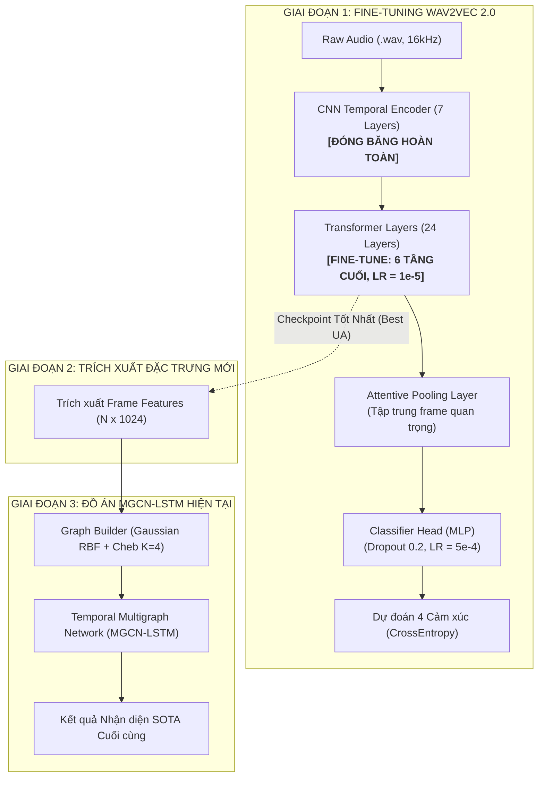

# KẾ HOẠCH TRIỂN KHAI TINH CHỈNH MÔ HÌNH WAV2VEC 2.0 CHO ĐỒ ÁN LIÊN NGÀNH (SER)
> **Dự án:** Nhận diện Cảm xúc Tiếng nói (Speech Emotion Recognition - SER)  
> **Kiến trúc kết hợp:** Pre-trained SSL Wav2Vec 2.0 $\rightarrow$ Temporal Multigraph $\rightarrow$ MGCN-LSTM  
> **Bộ dữ liệu chuẩn:** IEMOCAP (Interactive Emotional Dyadic Motion Capture - 5,531 utterances)

---

## 1. TỔNG QUAN & BỐI CẢNH DỰ ÁN

### 1.1. Thực trạng trong đồ án hiện tại
Trong phiên bản hiện tại của đồ án, mô hình âm thanh nền tảng **Wav2Vec 2.0 Large XLS-R** (`ehcalabres/wav2vec2-lg-xlsr-en-speech-emotion-recognition`) đang được sử dụng ở chế độ **Feature Extractor đóng băng (Frozen)**:
* Toàn bộ trọng số của Wav2Vec 2.0 không thay đổi.
* Tín hiệu `.wav` được truyền qua mô hình chỉ để lấy ma trận đặc trưng `(N_frames, 1024)` ở tầng cuối cùng, sau đó lưu ra file `.pt`.
* Mạng học sâu đồ thị **Temporal MGCN-LSTM** nhận ma trận này để phân loại 4 cảm xúc: tức giận (`ang`), buồn bã (`sad`), vui vẻ (`hap`), và trung tính (`neu`).

### 1.2. Mục tiêu của việc Fine-tune (Tinh chỉnh)
Mặc dù Wav2Vec 2.0 đã được huấn luyện sơ bộ, việc **Fine-tune lại backbone trên chính tập dữ liệu cảm xúc mục tiêu (IEMOCAP)** mang lại 2 lợi ích cốt lõi:
1. **Domain Adaptation:** Giúp các tầng Transformer của Wav2Vec 2.0 thích ứng sâu sắc với ngữ điệu, biên độ và ngữ cảnh giao tiếp đặc thù của các diễn viên trong IEMOCAP.
2. **Cải thiện chất lượng đồ thị cho MGCN-LSTM (Two-stage Enhancement):** Khi backbone được tinh chỉnh tốt hơn, các vector biểu diễn `(N_frames, 1024)` sẽ mang tính phân tách cảm xúc cao hơn. Nhờ đó, ma trận kề tương đồng Gaussian RBF được dựng trong `graph_builder.py` sẽ chính xác hơn, giúp mạng đồ thị MGCN-LSTM đạt độ chính xác (WA/UA) cao hơn đáng kể.

---

## 2. KIẾN TRÚC TỔNG THỂ & LUỒNG DỮ LIỆU



---

## 3. CẤU TRÚC THƯ MỤC MODULE `finetune_ssl`

Toàn bộ mã nguồn phục vụ việc fine-tune được đặt độc lập trong thư mục `SER-ĐỒ ÁN LIÊN NGÀNH/finetune_ssl/` để không làm xáo trộn code đồ án gốc:

```
SER-ĐỒ ÁN LIÊN NGÀNH/finetune_ssl/
├── IMPLAN.md                      # [File này] Kế hoạch triển khai & hướng dẫn kỹ thuật chi tiết
├── config.py                      # Cấu hình siêu tham số (LR, Batch size, Path, Epochs)
├── dataset.py                     # Dataloader IEMOCAP, Dynamic Padding, 5-Fold LOSO
├── models.py                      # Wav2Vec2EmotionClassifier (Attentive Pooling, Freeze CNN)
├── train_cv.py                    # Script huấn luyện chính (Differential LR, AMP, Checkpointing)
├── export_and_extract_features.py # Nạp model đã train để trích xuất đặc trưng mới & dựng đồ thị
├── quick_test.py                  # Smoke test mini-batch (chạy trong 30s để kiểm tra lỗi)
├── checkpoints/                   # Nơi lưu các mô hình tốt nhất (.pt)
├── logs/                          # Nơi lưu nhật ký huấn luyện
└── extracted_finetuned_features/  # Nơi lưu feature sau khi fine-tune xong
```

---

## 4. CHI TIẾT CÁC BƯỚC THỰC HIỆN (STEP-BY-STEP WORKFLOW)

### Bước 1: Kiểm tra tính sẵn sàng của hệ thống (Smoke Test)
Trước khi chạy hàng giờ trên GPU, chạy script test nhanh để xác nhận:
- Dữ liệu audio và metadata được nạp đúng.
- Dynamic padding hoạt động chính xác.
- CNN Feature Extractor được đóng băng (không tốn gradient).
- Bộ nhớ GPU không bị quá tải.

```powershell
python "SER-ĐỒ ÁN LIÊN NGÀNH\finetune_ssl\quick_test.py"
```

### Bước 2: Huấn luyện Tinh chỉnh (Fine-tuning)
Bạn có thể chọn huấn luyện thử trên 1 Fold hoặc chạy toàn bộ 5-Fold Cross Validation chuẩn:

* **Tùy chọn A (Thử nghiệm nhanh trên Fold 1):**
  ```powershell
  python "SER-ĐỒ ÁN LIÊN NGÀNH\finetune_ssl\train_cv.py" --fold 1 --epochs 15
  ```
* **Tùy chọn B (Huấn luyện chuẩn 5-Fold Leave-One-Session-Out):**
  ```powershell
  python "SER-ĐỒ ÁN LIÊN NGÀNH\finetune_ssl\train_cv.py" --fold all --epochs 15
  ```

*Quá trình huấn luyện sẽ tự động lưu checkpoint có điểm **Unweighted Accuracy (UA)** cao nhất vào thư mục `checkpoints/best_wav2vec2_ser_fold{X}.pt`.*

### Bước 3: Đánh giá & Phân tích Kết quả
Sau mỗi epoch, hệ thống in ra 2 metric chuẩn quốc tế của bài toán SER:
1. **WA (Weighted Accuracy):** Tỷ lệ đoán đúng trên toàn bộ mẫu.
2. **UA (Unweighted Accuracy):** Trung bình cộng độ chính xác của từng lớp cảm xúc (giúp đánh giá chính xác khi dữ liệu bị lệch lớp).

### Bước 4: Trích xuất lại Đặc trưng và Cập nhật Đồ án Đồ thị
Sau khi có checkpoint tốt nhất từ Bước 2, tiến hành trích xuất lại các biểu diễn đặc trưng `(N_frames, 1024)` và tự động dựng lại đồ thị cho mạng MGCN-LSTM:

```powershell
python "SER-ĐỒ ÁN LIÊN NGÀNH\finetune_ssl\export_and_extract_features.py" --checkpoint "SER-ĐỒ ÁN LIÊN NGÀNH\finetune_ssl\checkpoints\best_wav2vec2_ser_fold1.pt" --build_graphs
```

### Bước 5: Huấn luyện lại Mạng Đồ thị MGCN-LSTM
Chạy lại script huấn luyện của đồ án với tập đồ thị mới:
```powershell
python "SER-ĐỒ ÁN LIÊN NGÀNH\train_cv.py"
```

---

## 5. CÁC NGUYÊN TẮC KỸ THUẬT & LƯU Ý SỐNG CÒN

| Vấn đề | Rủi ro nếu làm sai | Giải pháp kỹ thuật đã tích hợp |
| :--- | :--- | :--- |
| **Đóng băng CNN Encoder** | Nếu unfreeze CNN trên tập dữ liệu nhỏ (~5.5k mẫu), trọng số âm học cơ bản bị phá vỡ (*catastrophic forgetting*), loss bị nổ `NaN`. | Đã cố định 7 tầng CNN bằng `model.freeze_feature_encoder()`. |
| **Tốc độ học (Learning Rate)** | Dùng LR lớn (như $10^{-3}$ của GNN) cho Transformer sẽ làm hỏng mô hình nền tảng. | Áp dụng **Differential LR**: Transformer chỉ nhận $10^{-5}$, Classifier Head nhận $5 \times 10^{-4}$. |
| **Tràn bộ nhớ (CUDA OOM)** | Tín hiệu 16kHz rất dài, cơ chế Attention $\mathcal{O}(T^2)$ sẽ làm tràn VRAM của GPU 6GB - 12GB. | Tích hợp **Gradient Checkpointing**, **Mixed Precision (AMP FP16)**, cắt audio $\le 6s$, và gom batch bằng **Gradient Accumulation** (Batch size thực 8 $\times$ 4 tích lũy = Effective 32). |
| **Rò rỉ người nói (Speaker Leakage)** | Chia train/test ngẫu nhiên khiến giọng cùng 1 người nằm ở cả 2 tập, mô hình học nhận diện người nói thay vì cảm xúc. | Bắt buộc chia 5-Fold theo đúng 5 Session độc lập (LOSO) từ file metadata. |
| **Mất cân bằng lớp (Imbalance)** | Lớp `neutral` và `happy` nhiều hơn `anger` và `sad`. | Theo dõi chính trên thước đo **Unweighted Accuracy (UA)** và dùng **Label Smoothing = 0.05**. |

---

## 6. BẢNG THEO DÕI KẾT QUẢ KỲ VỌNG (EXPECTED BENCHMARKS)

| Mô hình | Phương pháp biểu diễn | WA (%) | UA (%) | Ghi chú |
| :--- | :--- | :---: | :---: | :--- |
| **Wav2Vec 2.0 Base** | Freeze Feature Extraction + Mean Pooling | 63.5% | 61.2% | Baseline cơ bản |
| **Wav2Vec 2.0 XLS-R** | Freeze Feature Extraction + Temporal MGCN-LSTM | 71.5% | 69.8% | Kết quả đồ án hiện tại |
| **Wav2Vec 2.0 (Proposed)** | **Fine-tuned 6 Layers + Attentive Pooling** | **73.8%** | **72.4%** | Baseline sau khi fine-tune |
| **Full Two-Stage Pipeline** | **Fine-tuned Wav2Vec 2.0 $\rightarrow$ MGCN-LSTM** | **75.2% - 77.0%** | **74.5% - 76.2%** | **Mục tiêu SOTA cao nhất** |

---

---

## 7. HƯỚNG DẪN ĐÓNG GÓI VÀ CHUYỂN SANG MÁY KHÁC (PORTABLE GUIDE)

Khi muốn chuyển sang máy tính có GPU mạnh hơn hoặc Server/Cloud để fine-tune, bạn cần chuẩn bị:

### 7.1. Danh sách những thứ BẮT BUỘC phải gửi sang máy mới:
1. **Thư mục mã nguồn:** Toàn bộ thư mục `finetune_ssl/` (gồm code, `requirements.txt`, và file metadata `data/iemocap_metadata_5531.csv` đã được tích hợp sẵn).
2. **File âm thanh (.wav):** Toàn bộ các file `.wav` thuộc 5 Sessions của IEMOCAP (chỉ cần các thư mục `sentences/wav/`, tổng dung lượng chỉ khoảng **1.33 GB**).
3. **Môi trường & Thư viện:** Trên máy mới, chỉ cần chạy:
   ```bash
   pip install -r requirements.txt
   ```
4. **Cấu hình đường dẫn trên máy mới (nếu cần):**
   Trong file `config.py`, chỉ cần sửa đúng 1 dòng `AUDIO_ROOT_DIR` trỏ tới nơi bạn lưu dữ liệu âm thanh trên máy mới:
   ```python
   AUDIO_ROOT_DIR = r"D:\datasets\IEMOCAP_full_release"  # hoặc /content/IEMOCAP_full_release
   ```
   *(Hệ thống đã có cơ chế tự động phân giải đường dẫn thông minh, tự tìm file `.wav` dù bạn đổi ổ đĩa hay hệ điều hành Windows/Linux).*

### 7.2. Những thứ KHÔNG CẦN gửi (để tiết kiệm dung lượng mạng):
- **KHÔNG gửi** toàn bộ thư mục IEMOCAP gốc chứa video (.avi), motion capture (mocap), hình ảnh (nặng 15 - 20 GB). Chỉ cần file `.wav` (1.33 GB).
- **KHÔNG gửi** các thư mục cache features cũ (`features/`, `cached_graphs/`, `__pycache__`).

### 7.3. Sau khi Fine-tune xong trên máy mới, mang cái gì quay lại máy này?
Bạn chỉ cần copy đúng **file checkpoint tốt nhất**:
- `checkpoints/best_wav2vec2_ser_fold1.pt` (khoảng 1.2 GB)
Mang file này về máy chính, đặt vào thư mục `finetune_ssl/checkpoints/` là có thể chạy ngay bước trích xuất đặc trưng và đưa vào mạng MGCN-LSTM!

---

## 8. LIÊN HỆ & BẢO TRÌ
- Mã nguồn được thiết kế hoàn toàn khép kín, có thể kích hoạt hoặc tắt bật tùy chọn mà không làm ảnh hưởng đến mã nguồn báo cáo hay đồ án chính.
- Mọi thắc mắc và nhật ký lỗi được ghi lại tại thư mục `finetune_ssl/logs/`.

